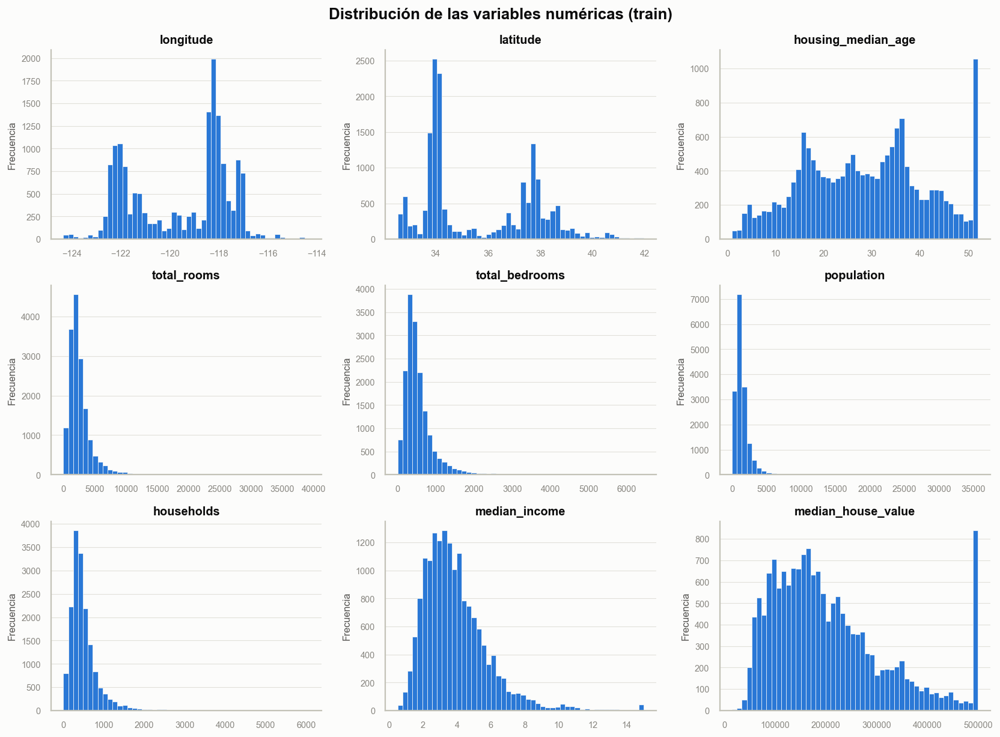
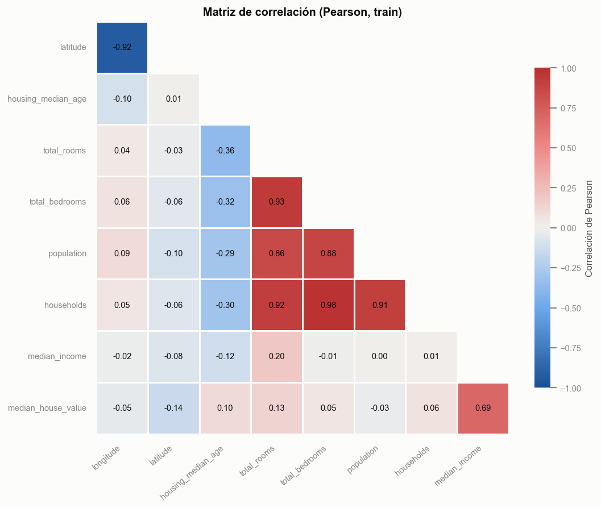
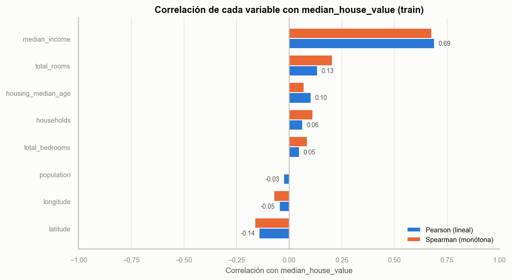
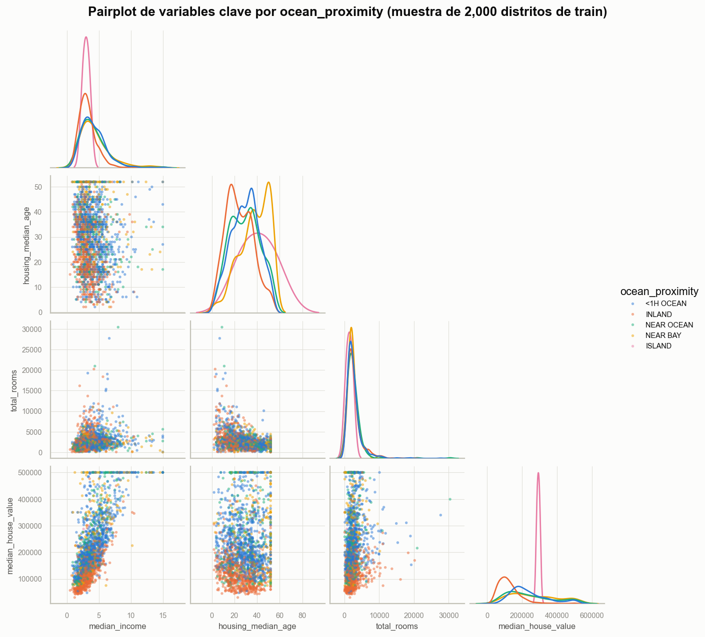
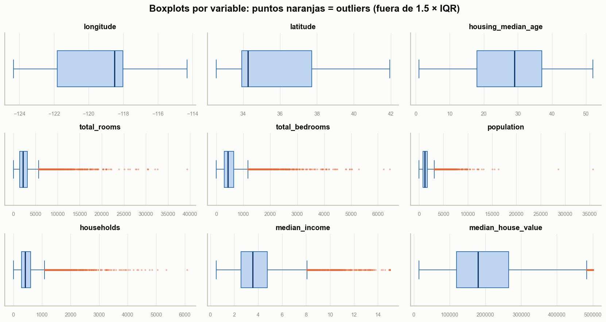
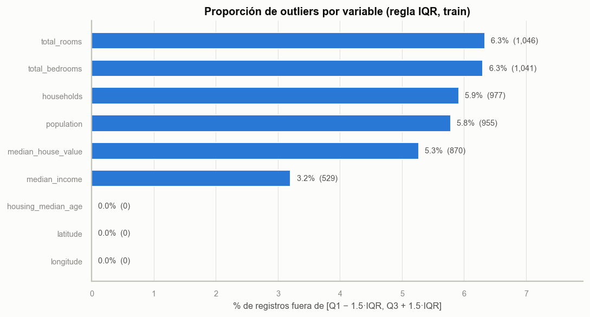
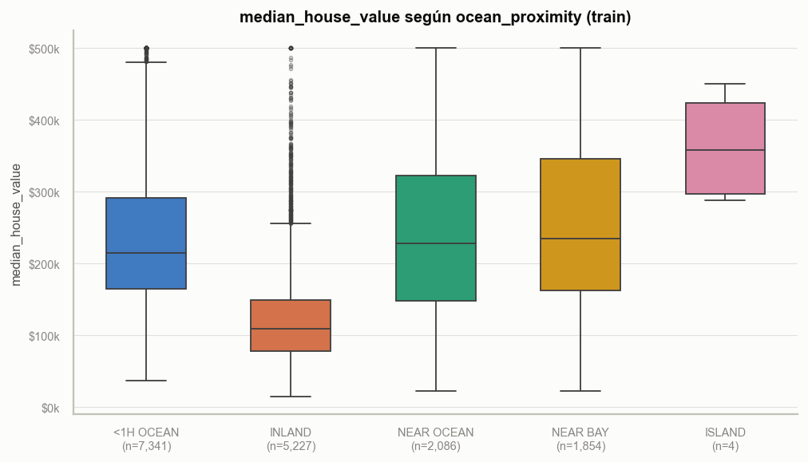
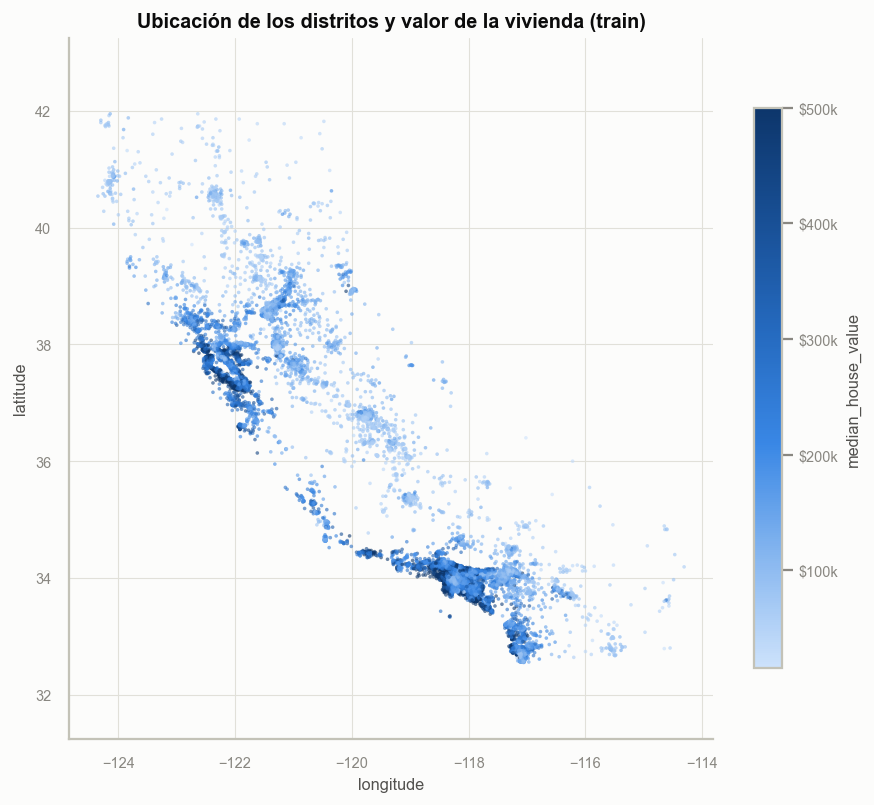

# Pipeline de Preprocesamiento Robusto con Scikit-Learn

Pre-entrega: construcción de un pipeline reutilizable que automatiza la limpieza y transformación de datos y los deja listos para un modelo de Machine Learning, evitando la fuga de datos (*data leakage*) y garantizando que el preprocesamiento sea idéntico en entrenamiento y en inferencia.

## Dataset

**California Housing** (versión de *Hands-On Machine Learning*, A. Géron), basada en el censo de California de 1990. Cada fila representa un distrito (block group) y la tarea es de **regresión**: predecir el valor mediano de las viviendas.

| Columna | Tipo | Descripción |
|---|---|---|
| `longitude` | numérica | Longitud del distrito |
| `latitude` | numérica | Latitud del distrito |
| `housing_median_age` | numérica | Antigüedad mediana de las viviendas (años) |
| `total_rooms` | numérica | Total de habitaciones del distrito |
| `total_bedrooms` | numérica | Total de dormitorios (**contiene valores nulos**) |
| `population` | numérica | Población del distrito |
| `households` | numérica | Cantidad de hogares |
| `median_income` | numérica | Ingreso mediano (en decenas de miles de USD) |
| `ocean_proximity` | **categórica** | Cercanía al océano: `<1H OCEAN`, `INLAND`, `NEAR OCEAN`, `NEAR BAY`, `ISLAND` |
| `median_house_value` | **objetivo** | Valor mediano de la vivienda (USD) |

- ~20.640 registros, 10 columnas.
- Fuente: https://github.com/ageron/handson-ml2/tree/master/datasets/housing
- Se eligió esta versión (y no `fetch_california_housing` de sklearn) porque incluye una variable categórica y valores nulos reales, lo que permite ejercitar todo el `ColumnTransformer`.

El CSV se descarga automáticamente en `data/housing.csv` la primera vez que se ejecuta el código.

## Estructura del repositorio

```
.
├── README.md
├── requirements.txt
├── .gitignore
├── main.py                # punto de entrada: EDA, entrena, evalúa, exporta y predice
├── data/                  # housing.csv (se descarga al ejecutar)
├── models/                # pipeline entrenado (.joblib)
├── reports/
│   ├── correlaciones.csv  # matriz de correlación de Pearson
│   ├── outliers_iqr.csv   # límites IQR y % de outliers por variable
│   └── figures/           # gráficos del análisis exploratorio (.png)
└── src/
    ├── __init__.py
    ├── eda.py             # análisis exploratorio: pairplot, heatmap, correlaciones, outliers
    ├── pipeline.py        # carga, split, ColumnTransformer, Pipeline, métricas y joblib
    └── predict.py         # carga del pipeline y predicción sobre datos nuevos
```

## Diseño del pipeline

```
Pipeline
├── preprocessor: ColumnTransformer
│   ├── num          → SimpleImputer(median) → StandardScaler
│   ├── cat          → SimpleImputer(most_frequent) → OneHotEncoder(handle_unknown="ignore")
│   └── missing_flag → MissingIndicator (flag 0/1 de trazabilidad de nulos)
└── model: LinearRegression
```

**Decisiones**
- **Split antes de ajustar:** `train_test_split` se ejecuta antes de cualquier `fit`. El imputador, el scaler y el encoder aprenden sus parámetros solo con `X_train`; el test se transforma con esos parámetros. Así no hay *data leakage*.
- **Mediana para numéricas:** variables como `total_rooms` o `population` tienen outliers, y la mediana es más robusta que la media.
- **`handle_unknown="ignore"`:** si en producción llega una categoría no vista en entrenamiento, se codifica como un vector de ceros en lugar de lanzar un error.
- **Flag de trazabilidad de nulos:** por cada columna que tenía valores nulos en entrenamiento (en este dataset, `total_bedrooms`) se agrega una columna binaria `<columna>_era_null`: **1** si el valor original era nulo y fue imputado, **0** si estaba presente. Se implementa con `MissingIndicator` en una rama separada del `ColumnTransformer`, para que el flag no pase por el `StandardScaler` y se mantenga como 0/1. Además de servir para auditar qué valores fueron imputados, el modelo lo recibe como una variable más, por si el hecho de que falte el dato aporta información. La función `get_missing_flags()` de `src/pipeline.py` devuelve estos flags para cualquier conjunto de datos.
- **Un único objeto:** preprocesamiento + modelo se entrenan con un solo `fit` y se usan con un solo `predict`, lo que asegura consistencia entre entrenamiento e inferencia.

## Análisis exploratorio (EDA)

El módulo `src/eda.py` genera automáticamente las visualizaciones y reportes del análisis exploratorio cada vez que se ejecuta `main.py`. Se guardan en `reports/figures/` (gráficos) y `reports/` (tablas en CSV).

> **El EDA se hace solo sobre el conjunto de entrenamiento.** Igual que el preprocesamiento, el análisis no mira el test: así ninguna decisión (qué imputar, cómo tratar outliers, qué variables usar) se toma con información que el modelo no debería conocer (*data snooping*).

| Archivo | Qué muestra | Para qué sirve |
|---|---|---|
| `01_distribuciones.png` | Histograma de cada variable numérica y del objetivo | Ver asimetrías, escalas distintas y valores tope (saturación) |
| `02_heatmap_correlaciones.png` | Heatmap de correlación de Pearson entre todas las numéricas | Detectar variables redundantes (multicolinealidad) y relaciones con el objetivo |
| `03_correlacion_con_objetivo.png` | Correlación de Pearson (lineal) y Spearman (monótona) de cada variable con `median_house_value` | Ranking de qué variables explican mejor el objetivo |
| `04_pairplot.png` | Pairplot de `median_income`, `housing_median_age`, `total_rooms` y el objetivo, coloreado por `ocean_proximity` | Ver relaciones de a pares y cómo se separan las categorías |
| `05_boxplots_outliers.png` | Boxplot de cada variable; los puntos naranjas son outliers | Visualizar la dispersión y los valores extremos |
| `06_outliers_iqr.png` | % de outliers por variable según la regla 1.5 × IQR | Cuantificar qué variables tienen más valores extremos |
| `07_valor_por_proximidad.png` | Boxplot del objetivo para cada categoría de `ocean_proximity`, con la cantidad de registros | Ver si la variable categórica aporta información |
| `08_mapa_geografico.png` | Distritos ubicados por longitud/latitud y coloreados por valor de vivienda | Ver el patrón geográfico (costa vs. interior) |
| `correlaciones.csv` | Matriz de correlación en formato tabla | Consultar los valores exactos |
| `outliers_iqr.csv` | Q1, Q3, IQR, límites, cantidad y % de outliers por variable | Consultar los valores exactos |

**Cómo se detectan los outliers (regla IQR):** para cada variable se calcula el rango intercuartílico `IQR = Q3 − Q1`; se considera outlier todo valor menor a `Q1 − 1.5·IQR` o mayor a `Q3 + 1.5·IQR`. Es el mismo criterio que usan los bigotes de los boxplots.

**Qué tratamiento reciben:** los outliers **no se eliminan**. En este dataset la mayoría son distritos reales (muy poblados o de ingresos altos), no errores de carga. En su lugar, el pipeline usa la **mediana** para imputar (no se ve afectada por valores extremos). El análisis queda documentado para justificar esa decisión.

### Gráficos

> Las imágenes se generan al ejecutar `python main.py`. Para que aparezcan acá en GitHub, subí la carpeta `reports/` junto con el resto del código.










### Qué buscar en los gráficos

En este dataset es esperable observar lo siguiente (verificalo con los gráficos de tu ejecución):

- **`median_income` es la variable más correlacionada con el objetivo**, y la relación se ve casi lineal en el pairplot.
- **`total_rooms`, `total_bedrooms`, `population` y `households` están muy correlacionadas entre sí** (todas miden el "tamaño" del distrito). Para una regresión lineal es multicolinealidad; no rompe las predicciones, pero hace menos interpretables los coeficientes individuales.
- **El objetivo y `housing_median_age` tienen un tope**: en los histogramas aparece una barra alta al final, porque los valores se truncaron en el dataset original.
- **Las variables de conteo tienen muchos outliers** del lado derecho: distritos muy grandes.
- **`INLAND` tiene valores de vivienda claramente menores** que las categorías cercanas a la costa, lo que justifica incluir `ocean_proximity` en el modelo. `ISLAND` tiene muy pocos registros.

## Cómo ejecutarlo paso a paso

Las instrucciones sirven para **Windows**, **macOS** y **Linux**. Cuando un comando cambia según el sistema operativo, se indican las dos variantes.

### Paso 0: Requisitos previos

Necesitás tener instalado:

| Herramienta | Versión | Para qué | Dónde conseguirla |
|---|---|---|---|
| **Python** | 3.10 o superior | Ejecutar el código | https://www.python.org/downloads/ |
| **Git** | cualquiera | Clonar el repositorio (opcional, ver Paso 1) | https://git-scm.com/downloads |
| **Conexión a internet** | — | Instalar librerías y descargar el dataset la primera vez | — |

> **Windows:** al instalar Python, marcá la casilla **"Add Python to PATH"** en la primera pantalla del instalador. Si no lo hacés, la terminal no va a reconocer el comando `python`.

Para verificar que quedaron instalados, abrí una terminal y ejecutá:

```bash
python --version
git --version
```

Deberías ver algo como `Python 3.12.x` y `git version 2.x`.

> **¿Cómo abro una terminal?**
> - **Windows:** tecla Windows → escribí `PowerShell` → Enter.
> - **macOS:** `Cmd + Espacio` → escribí `Terminal` → Enter.
> - **Linux:** `Ctrl + Alt + T`.
>
> En macOS/Linux, si `python` no funciona, probá con `python3` (y `pip3` en lugar de `pip`). En Windows, si no funciona `python`, probá con `py`.

### Paso 1: Descargar el proyecto

**Opción A: con Git (recomendada)**

```bash
git clone https://github.com/TU-USUARIO/pipeline-preprocesamiento.git
cd pipeline-preprocesamiento
```

**Opción B: sin Git**

1. En la página del repositorio en GitHub, hacé clic en el botón verde **Code** → **Download ZIP**.
2. Descomprimí el archivo.
3. En la terminal, entrá a la carpeta descomprimida:
   ```bash
   cd ruta/a/pipeline-preprocesamiento
   ```

> A partir de acá, **todos los comandos se ejecutan desde la carpeta raíz del proyecto** (la que contiene `main.py`). Podés comprobarlo con `ls` (macOS/Linux) o `dir` (Windows): tenés que ver `main.py`, `src/`, `README.md`, etc.

### Paso 2: Crear un entorno virtual

El entorno virtual aísla las librerías de este proyecto para que no interfieran con otras instalaciones de Python.

```bash
python -m venv .venv
```

Esto crea una carpeta `.venv/` dentro del proyecto (ya está excluida de Git en `.gitignore`).

### Paso 3: Activar el entorno virtual

**Windows (PowerShell):**
```powershell
.venv\Scripts\Activate.ps1
```

**Windows (CMD):**
```cmd
.venv\Scripts\activate.bat
```

**macOS / Linux:**
```bash
source .venv/bin/activate
```

Si se activó bien, vas a ver `(.venv)` al principio de la línea de la terminal.

> **Error en PowerShell** del tipo *"la ejecución de scripts está deshabilitada en este sistema"*: ejecutá una sola vez
> ```powershell
> Set-ExecutionPolicy -Scope CurrentUser -ExecutionPolicy RemoteSigned
> ```
> confirmá con `S` (o `Y`) y volvé a intentar el Paso 3.

### Paso 4: Instalar las dependencias

Con el entorno activado:

```bash
python -m pip install --upgrade pip
pip install -r requirements.txt
```

Se instalan `pandas`, `numpy`, `scikit-learn`, `joblib`, `matplotlib` y `seaborn`. Puede tardar uno o dos minutos.

### Paso 5: Ejecutar el proyecto

```bash
python main.py
```

Si querés omitir los gráficos (por ejemplo, para una ejecución más rápida):

```bash
python main.py --sin-graficos
```

El script hace todo el flujo automáticamente:

1. **Descarga el dataset** a `data/housing.csv` (solo la primera vez; las siguientes lo lee del disco).
2. **Explora los datos:** muestra la forma, los tipos de cada columna y los valores nulos.
3. **Divide en Train/Test** (80 % / 20 %) antes de ajustar cualquier transformación.
4. **Genera el análisis exploratorio** sobre train: muestra en consola las correlaciones con el objetivo y los outliers por variable, y guarda los 8 gráficos en `reports/figures/` y las tablas en `reports/`. Los gráficos se guardan como archivos; no se abre ninguna ventana.
5. **Entrena el pipeline** (preprocesamiento + regresión lineal), informa los **flags de trazabilidad** creados y cuántos valores se imputaron, y **muestra las métricas** MAE, RMSE y R² sobre el conjunto de test.
6. **Exporta el pipeline** entrenado a `models/pipeline_housing.joblib`.
7. **Vuelve a cargarlo desde disco y predice** sobre 3 registros nuevos, uno con un valor nulo (que aparece con flag `total_bedrooms_era_null = 1`) y otro con una categoría que no existe en el dataset.

### Paso 6: Verificar la salida

La salida en la terminal tiene esta forma (los números exactos dependen de los datos):

```
============================================================
1. EXPLORACIÓN, ENTRENAMIENTO Y EVALUACIÓN
============================================================
Forma del dataset: (20640, 10)
...
Valores nulos por columna:
total_bedrooms    207

Train: (16512, 9) | Test: (4128, 9)
Numéricas (8): ['longitude', 'latitude', ..., 'median_income']
Categóricas (1): ['ocean_proximity']

Correlación con median_house_value (Pearson / Spearman):
                    Pearson  Spearman
median_income         ...       ...
...

Outliers por variable (regla 1.5 × IQR):
                    outliers  porcentaje
...

Gráficos guardados en reports/figures/:
  - 01_distribuciones.png
  - 02_heatmap_correlaciones.png
  - 03_correlacion_con_objetivo.png
  - 04_pairplot.png
  - 05_boxplots_outliers.png
  - 06_outliers_iqr.png
  - 07_valor_por_proximidad.png
  - 08_mapa_geografico.png

Flags de trazabilidad creados: ['total_bedrooms_era_null']
Valores imputados en train (cantidad de 1 por flag):
total_bedrooms_era_null    ...

Métricas en test:
   MAE: ...
  RMSE: ...
    R2: ...

Pipeline guardado en: models/pipeline_housing.joblib

============================================================
2. PREDICCIÓN SOBRE DATOS NUEVOS (pipeline cargado con joblib)
============================================================
 total_bedrooms  median_income ocean_proximity  total_bedrooms_era_null  prediccion_usd
          129.0         8.3252        NEAR BAY                        0             ...
            NaN         3.5000       <1H OCEAN                        1             ...
          300.0         4.2000          DESERT                        0             ...
```

Además, se generan estos archivos:
- `data/housing.csv`: el dataset descargado.
- `models/pipeline_housing.joblib`: el pipeline entrenado, listo para reutilizar.
- `reports/figures/*.png`: los 8 gráficos del análisis exploratorio. Abrilos con cualquier visor de imágenes.
- `reports/correlaciones.csv` y `reports/outliers_iqr.csv`: las tablas del análisis, que se pueden abrir con Excel.

> Antes de subir el proyecto a GitHub, ejecutá `python main.py` y subí también la carpeta `reports/`, así los gráficos se ven directamente en este README.

### Paso 7 (opcional): Usar el pipeline guardado desde otro código

Una vez ejecutado `main.py`, el pipeline se puede cargar y usar sin volver a entrenar:

```python
import joblib
import pandas as pd

pipeline = joblib.load("models/pipeline_housing.joblib")

nuevo = pd.DataFrame([{
    "longitude": -122.25, "latitude": 37.85, "housing_median_age": 30.0,
    "total_rooms": 1500.0, "total_bedrooms": 300.0, "population": 800.0,
    "households": 280.0, "median_income": 5.0, "ocean_proximity": "NEAR BAY",
}])

print(pipeline.predict(nuevo))

# Flags de trazabilidad (1 = el valor original era nulo)
from src.pipeline import get_missing_flags
print(get_missing_flags(pipeline, nuevo))
```

Los datos se pasan **crudos**, con las mismas columnas que el CSV original (sin `median_house_value`); el pipeline se encarga de imputar, escalar y codificar.

### Paso 8: Desactivar el entorno

Cuando termines:

```bash
deactivate
```

La próxima vez que quieras ejecutarlo, solo repetí el **Paso 3** (activar) y el **Paso 5** (ejecutar); no hace falta reinstalar nada.

### Solución de problemas

| Problema | Causa probable | Solución |
|---|---|---|
| `'python' no se reconoce como un comando...` | Python no está en el PATH | Reinstalá Python marcando **"Add Python to PATH"**, o usá `py` (Windows) / `python3` (macOS/Linux) |
| `ModuleNotFoundError: No module named 'sklearn'` (o `pandas`) | El entorno virtual no está activado o no se instalaron las dependencias | Activá el entorno (Paso 3) y ejecutá `pip install -r requirements.txt` |
| `ModuleNotFoundError: No module named 'src'` | Se ejecutó `main.py` desde otra carpeta | Entrá a la carpeta raíz del proyecto con `cd` y ejecutá `python main.py` |
| Error de conexión / `URLError` al descargar el dataset | Sin internet o red con restricciones | Descargá manualmente [housing.csv](https://raw.githubusercontent.com/ageron/handson-ml2/master/datasets/housing/housing.csv) (clic derecho → *Guardar como*) y guardalo en `data/housing.csv` |
| `FileNotFoundError: models/pipeline_housing.joblib` | Se intentó cargar el pipeline sin haberlo entrenado | Ejecutá primero `python main.py` |
| `ModuleNotFoundError: No module named 'matplotlib'` (o `seaborn`) | Las dependencias se instalaron antes de que se agregaran las librerías de gráficos | Con el entorno activado, volvé a ejecutar `pip install -r requirements.txt` |
| La carpeta `reports/figures/` está vacía | Se ejecutó con `--sin-graficos` | Ejecutá `python main.py` sin esa opción |
| PowerShell no deja activar el entorno | Política de ejecución de scripts | Ver la nota del Paso 3 |

## Resultados

Métricas sobre el conjunto de test (20 % de los datos, `random_state=42`):

| Métrica | Valor |
|---|---|
| MAE | _completar_ |
| RMSE | _completar_ |
| R² | _completar_ |

La segunda parte de `main.py` demuestra que el pipeline exportado predice sin errores sobre datos crudos que incluyen un valor nulo (marcado con `total_bedrooms_era_null = 1`) y una categoría desconocida (`"DESERT"`).

## Cumplimiento de la consigna

| Criterio | Dónde |
|---|---|
| README con descripción del dataset | Este archivo |
| `Pipeline` con al menos dos pasos de transformación | `build_pipeline()` en `src/pipeline.py` (imputer → scaler / imputer → onehot, y preprocesador → modelo) |
| `ColumnTransformer` que diferencia numéricas y categóricas | `preprocessor` en `build_pipeline()` (`src/pipeline.py`) |
| División Train/Test antes de ajustar el preprocesamiento | `train()` en `src/pipeline.py`: `train_test_split` antes de `fit` |
| Pipeline funcional con `.predict()` sobre datos nuevos | `predict()` en `src/predict.py`, ejecutado desde `main.py` |
| Flag de trazabilidad de nulos (0/1) | rama `missing_flag` en `build_pipeline()` y `get_missing_flags()` en `src/pipeline.py` |
| EDA: pairplot, heatmap, correlaciones y outliers | `src/eda.py` (`run_eda()`), gráficos en `reports/figures/` |
| Exportación con `joblib` | `joblib.dump` en `train()` y `joblib.load` en `src/predict.py` |
